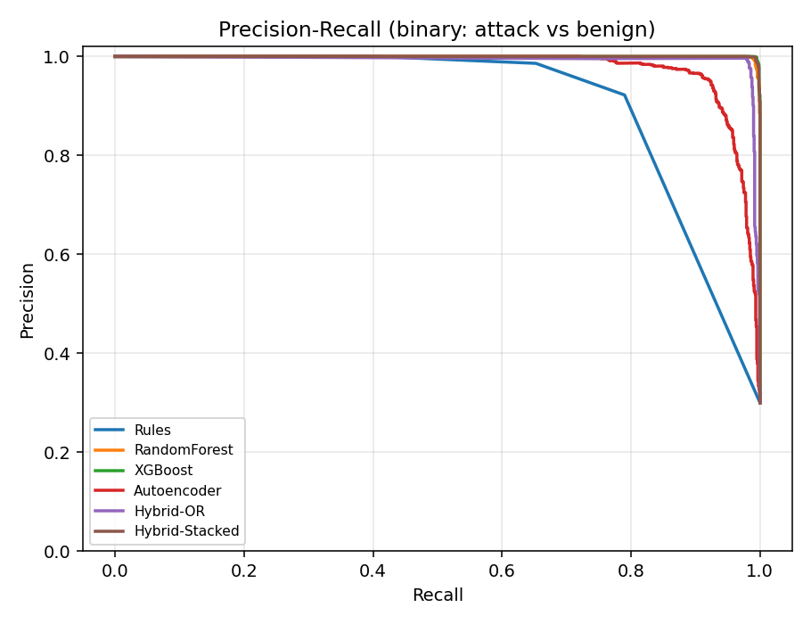
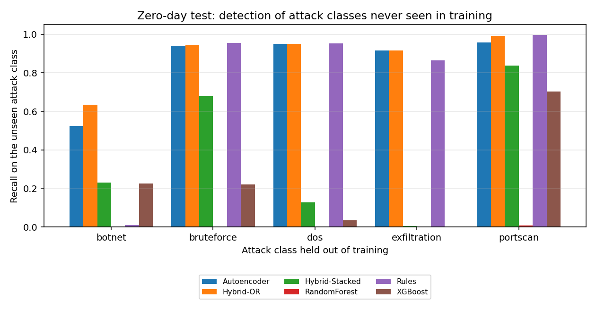
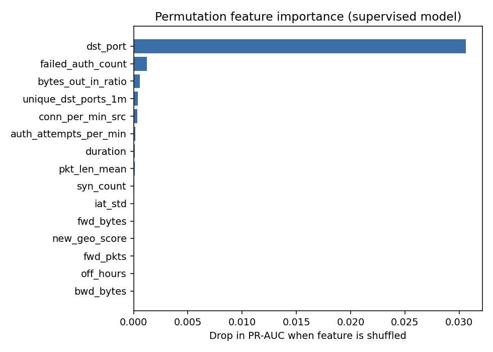
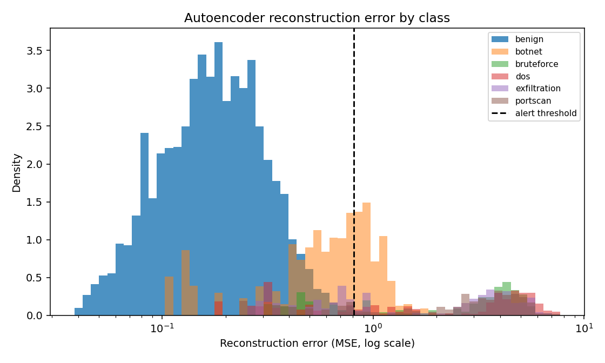

# Cloud Intrusion Detection - Experiment Report

*Dataset:* `synthetic`  |  train/val/test = 12,000 / 4,000 / 4,000  |  features = 24

*Backends:* supervised boosting = **sklearn HistGradientBoosting (XGBoost fallback)**, autoencoder = **sklearn**; AE threshold = benign-val p99.

## 1. Closed-world results (all attack types seen in training)

| detector | precision | recall | f1 | fpr | pr_auc | roc_auc | macro_f1_multiclass |
|---|---|---|---|---|---|---|---|
| Rules | 0.9222 | 0.7900 | 0.8510 | 0.0286 | 0.8389 | 0.8893 | nan |
| RandomForest | 1.0000 | 0.9767 | 0.9882 | 0.0000 | 0.9996 | 0.9998 | 0.9877 |
| XGBoost | 1.0000 | 0.9900 | 0.9950 | 0.0000 | 0.9998 | 0.9999 | 0.9955 |
| Autoencoder | 0.9740 | 0.8733 | 0.9209 | 0.0100 | 0.9779 | 0.9852 | nan |
| Hybrid-OR | 0.9770 | 0.9900 | 0.9834 | 0.0100 | 0.9915 | 0.9958 | nan |
| Hybrid-Stacked | 0.9992 | 0.9883 | 0.9937 | 0.0004 | 0.9998 | 0.9999 | nan |

Per-class detection rate (benign column = true-negative rate):

| item | Rules | RandomForest | XGBoost | Autoencoder | Hybrid-OR | Hybrid-Stacked |
|---|---|---|---|---|---|---|
| benign | 0.9714 | 1.0000 | 1.0000 | 0.9900 | 0.9900 | 0.9996 |
| botnet | 0.0100 | 0.9550 | 0.9950 | 0.5250 | 0.9950 | 0.9800 |
| bruteforce | 0.9542 | 0.9750 | 0.9958 | 0.9417 | 0.9958 | 0.9875 |
| dos | 0.9531 | 0.9719 | 0.9844 | 0.9500 | 0.9844 | 0.9906 |
| exfiltration | 0.8650 | 0.9850 | 0.9800 | 0.9150 | 0.9800 | 0.9850 |
| portscan | 0.9958 | 0.9958 | 0.9958 | 0.9583 | 0.9958 | 0.9958 |

## 2. Zero-day results (attack class removed from training)

Recall on the **unseen** class (each row = a separate retraining):

| holdout | Autoencoder | Hybrid-OR | Hybrid-Stacked | RandomForest | Rules | XGBoost |
|---|---|---|---|---|---|---|
| botnet | 0.5250 | 0.6350 | 0.2300 | 0.0000 | 0.0100 | 0.2250 |
| bruteforce | 0.9417 | 0.9458 | 0.6792 | 0.0000 | 0.9542 | 0.2208 |
| dos | 0.9500 | 0.9500 | 0.1281 | 0.0000 | 0.9531 | 0.0344 |
| exfiltration | 0.9150 | 0.9150 | 0.0050 | 0.0000 | 0.8650 | 0.0000 |
| portscan | 0.9583 | 0.9917 | 0.8375 | 0.0083 | 0.9958 | 0.7042 |

Mean false-positive rate across those runs:

| detector | mean_fpr |
|---|---|
| Autoencoder | 0.0100 |
| Hybrid-OR | 0.0100 |
| Hybrid-Stacked | 0.0002 |
| RandomForest | 0.0000 |
| Rules | 0.0286 |
| XGBoost | 0.0000 |

Recall on the *known* attack classes in the same runs:

| holdout | Autoencoder | Hybrid-OR | Hybrid-Stacked | RandomForest | Rules | XGBoost |
|---|---|---|---|---|---|---|
| botnet | 0.9430 | 0.9880 | 0.9870 | 0.9810 | 0.9460 | 0.9880 |
| bruteforce | 0.8562 | 0.9885 | 0.9885 | 0.9760 | 0.7490 | 0.9885 |
| dos | 0.8455 | 0.9909 | 0.9864 | 0.9795 | 0.7307 | 0.9909 |
| exfiltration | 0.8650 | 0.9930 | 0.9900 | 0.9740 | 0.7750 | 0.9930 |
| portscan | 0.8521 | 0.9896 | 0.9844 | 0.9688 | 0.7385 | 0.9896 |

## 3. Latency

| detector | batch_flows_per_sec | single_flow_ms |
|---|---|---|
| Rules | 5226722.1390 | 0.2210 |
| RandomForest | 93438.0860 | 8.0330 |
| XGBoost | 35333.8260 | 5.2300 |
| Autoencoder | 1064173.3790 | 0.4440 |
| Hybrid-OR | 37130.4680 | 5.2400 |
| Hybrid-Stacked | 38249.9980 | 5.2670 |

## 4. Explainability

Top features by permutation importance:

| item | pr_auc_drop |
|---|---|
| dst_port | 0.0306 |
| failed_auth_count | 0.0012 |
| bytes_out_in_ratio | 0.0006 |
| unique_dst_ports_1m | 0.0004 |
| conn_per_min_src | 0.0003 |
| auth_attempts_per_min | 0.0002 |
| duration | 0.0001 |
| pkt_len_mean | 0.0001 |
| syn_count | 0.0001 |
| iat_std | 0.0000 |

> **Note:** these numbers come from the *synthetic* generator, which exists to validate the pipeline. Re-run on CIC-IDS2017 / UNSW-NB15 for results you can report.
